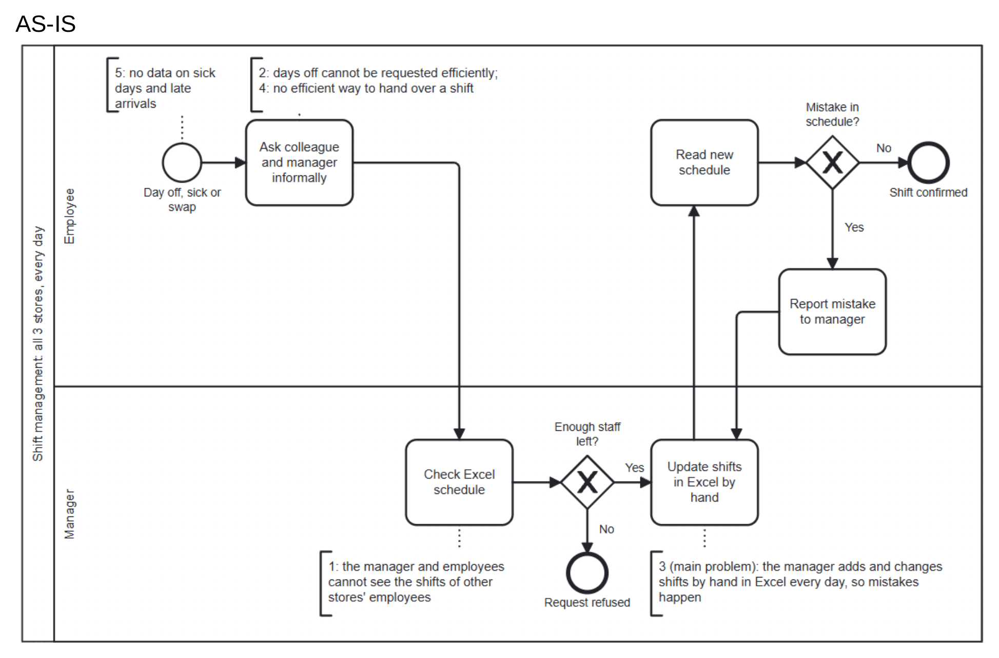

# FreshChoice – Shift Management Web Application

A web application that replaces the single Excel file FreshChoice uses to schedule staff across its three supermarkets. Managers plan rosters for all three locations from one place; employees check their shifts, request days off, change their availability and pick up posted shifts from their phone.

It is built as an ICT project at Fontys, following the full cycle of analysis, advice, design and implementation for a supermarket with one flagship store and two smaller neighbourhood shops.

## The problem

The schedule for all three stores lives in one Excel file on one manager's computer. Staff see it as a printout, a photo in a group chat or a forwarded message. Days off, swaps and availability changes are asked for verbally, by WhatsApp or on paper.

That produces five problems, which the whole project is measured against:

1. Managers cannot see the shifts of employees in the other stores.
2. Employees cannot request days off efficiently.
3. Mistakes in the schedule — the main problem: shifts are added and changed by hand every day.
4. No efficient way to hand a shift over to another employee.
5. No data on sickness and lateness.

The current process, with those problems numbered on the flows:



## What it does

Two portals, one database:

- **Manager portal** — assign and change shifts for all three stores, see coverage per store, approve or decline requests and availability changes, create employee accounts, and read statistics on lateness, sickness and contract hours.
- **Staff portal** — mobile-first view of own shifts, day-off requests with a status, availability changes, posted shifts to claim, and group chat with the team.

Before anything is published, the schedule is checked automatically: overlapping shifts, a second shift at another store, too little rest between two shifts, availability the employee has not marked, and shifts left without enough staff. Data problems block the change; judgement calls warn the manager, who can override them with a reason.

## Scope

Twenty-one functional requirements, prioritised with MoSCoW: 7 Must, 7 Should, 6 Could, 1 Won't. The first version is the Must list.

| ID | Requirement |
| --- | --- |
| FR-01 | Different login for employees and managers |
| FR-03 | Employee can view their schedule |
| FR-04 | Manager can assign shifts |
| FR-05 | Manager can see information for all three stores |
| FR-12 | Manager can create accounts in the app for employees |
| FR-13 | Manager can manually change the schedule |
| FR-14 | Manager can approve requests and availability changes |

Out of scope for this release: the clock-in system (FR-21), payroll calculation, and automatic replacement suggestions. The Should items — day-off requests, shift posts, availability changes, chat, password reset — follow once the Must list works, and the Could items last.

## Technology

| Layer | Technology |
| --- | --- |
| Structure | HTML |
| Presentation | CSS with Bootstrap 5, themed through CSS variable overrides |
| Server-side | PHP 8: sessions, validation, business rules, page rendering |
| Client-side | JavaScript: form feedback, AJAX, polling |
| Data | MariaDB (MySQL-compatible), administered through phpMyAdmin |

A classic LAMP-style stack: free, documented, no build step, and hostable by FreshChoice itself. PHP renders the pages and enforces the rules before anything reaches the browser, and MariaDB keeps users, stores, shifts, requests and attendance in one place instead of three spreadsheets.

There is no WebSocket server, so chat and alerts are polled every few seconds. Delivery is near-real-time rather than instant, and the last fifty messages are rendered on page load so the conversation is always readable.

## Planned application structure

Nothing is built in this repository yet. The agreed layout keeps code out of the web root except for what the browser needs:

```
FreshChoice/
├── config/
│   └── db.php              # database connection and global constants
├── public/                 # the only folder the browser can reach
│   ├── css/
│   ├── js/
│   ├── images/
│   ├── index.php           # single entry point
│   └── .htaccess
├── app/
│   ├── controllers/        # request handling
│   ├── models/             # SQL and data access
│   └── views/              # templates, with partials/
└── README.md
```

## Database Setup (MariaDB / phpMyAdmin)

1. Start **Apache** and **MySQL** in the XAMPP Control Panel.
2. Open **phpMyAdmin** (`http://localhost/phpmyadmin`).
3. Import **`database/schema.sql`** first to create the `freshchoice_db` database and all 7 tables (`store`, `user`, `shift`, `request`, `availability`, `attendance`, `shift_post`).
4. Select `freshchoice_db` in the left sidebar and import **`database/seed.sql`** to populate the 3 Eindhoven stores, 20 test accounts, and sample schedules.
5. Verify that `db.php` points to `dbname=freshchoice_db` (default XAMPP credentials: user `root`, empty password `""`).

### Test Credentials
All 20 seeded accounts share the password: **`Password123!`**

| Role | Name | Store | Email |
| :--- | :--- | :--- | :--- |
| Manager | Emma de Vries | FreshChoice Flagship | `emma.manager@freshchoice.nl` |
| Manager | Liam van Dijk | FreshChoice Noord | `liam.manager@freshchoice.nl` |
| Manager | Mila Smit | FreshChoice Zuid | `mila.manager@freshchoice.nl` |
| Employee | Lucas Bakker | FreshChoice Flagship | `lucas@freshchoice.nl` |
| Employee | Sophie Jansen | FreshChoice Noord | `sophie@freshchoice.nl` |
| Employee | Noah Visser | FreshChoice Zuid | `noah@freshchoice.nl` |

